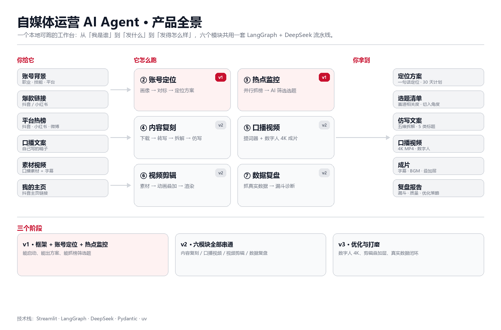

# 自媒体运营 AI Agent · 产品需求文档（PRD）

| 项 | 内容 |
|---|---|
| 文档版本 | v0.2（已定稿，待开工） |
| 日期 | 2026-10-29 |
| 仓库 | `E:\test\test1\learn_1\test\day05\media_agent` |
| 形态 | 本地单机 Web 应用（Streamlit），单用户 |
| 技术栈 | Python 3.12 · uv · Streamlit · LangGraph · DeepSeek · FunASR · HeyGem · DeepAgents · HyperFrames · ffmpeg |
| 交付方式 | 三阶段 v1 / v2 / v3，每阶段经确认后 commit + tag |

---

## 0. 一句话定义

把自媒体运营里最费时间的六件事——**定位、选题、拆爆款、出镜、剪辑、复盘**——做成一个本地跑得起来的 AI 工作台：用户只提供链接、文案和素材，其余由 LangGraph 工作流 + 本地模型 + ffmpeg 完成。



> 图里三列就是产品定位本身：左边是用户手上已有的东西（账号背景、爆款链接、热榜、文案、素材、主页），
> 中间是六个模块（红底 = v1 交付：账号定位、热点监控；灰底 = v2 交付），右边是用户真正拿走的东西。
> 图由 `docs/images/product_overview.png` 提供，源脚本在 `.cache/dev/make_overview_png.py`（改文案重跑即可）。

---

## 1. 背景与目标

### 1.1 背景

个人创作者和小团队做账号，卡点不在"想不想做"，而在六个重复劳动：

1. 不知道账号该怎么定位，凭感觉起号，30 天没起色就放弃；
2. 选题靠刷，刷到什么算什么，不知道什么和自己的赛道相关；
3. 看到爆款只会"觉得好"，拆不出钩子、结构、情绪节奏；
4. 口播要背稿，重拍十几遍；
5. 剪辑要一条条对字幕、加素材、配 BGM，一条 3 分钟视频剪 2 小时；
6. 发完只看播放量，不知道漏斗哪一环漏了。

这六件事恰好都能被"LLM 结构化输出 + 本地音视频工具"覆盖，且**不需要云端、不需要付费 SaaS、数据不出本机**。

### 1.2 产品目标

用一个 Streamlit 应用串起六模块工作流，让创作者在本地完成从"我该做什么号"到"这条为什么没流量"的完整闭环。

### 1.3 成功标准（整体）

- 一个新用户从打开页面到拿到一份可执行的定位方案 ≤ 5 分钟；
- 一条 3 分钟口播视频，从上传到成片 ≤ 15 分钟（不含人工审片）；
- 六个模块共用一套导航、一套配置、一套缓存目录，不出现"六个独立脚本"；
- 全流程离线可跑（LLM 除外），密钥只存在本地 `.env`。

### 1.4 非目标（本期不做）

- 多人协作、账号体系、权限、云端部署；
- 付费/订阅、数据看板大盘；
- 自动发布（一键发抖音/小红书）——平台风控不可控；
- 移动端适配（桌面优先）；
- 多语言（只做中文）。

---

## 2. 目标用户与使用场景

### 2.1 用户画像

| 画像 | 特征 | 最痛的模块 |
|---|---|---|
| A. 刚起号的个人创作者 | 有本职工作，想副业做号；不确定赛道 | 账号定位 |
| B. 已有账号但没流量 | 发了 30~100 条，播放卡在 500 | 数据复盘、内容复刻 |
| C. 日更口播博主 | 每天一条，拍摄剪辑占 4 小时 | 口播视频、视频剪辑 |
| D. 小团队运营 | 一人兼选题+剪辑 | 热点监控、内容复刻 |

### 2.2 典型端到端场景

**场景 1（起号）**：输入职业/技能/兴趣/目标/平台 → 拿到一句话定位 + 30 天起号计划 → 去"热点监控"按赛道找 10 个选题 → 挑一个进"内容复刻"仿写文案 → 进"口播视频"生成音频与数字人 → 进"视频剪辑"出片。

**场景 2（复盘）**：粘贴抖音主页链接 + Cookie → 拉到最近 20 条数据 → 看漏斗哪一环最差 → 拿优化策略里的"立即执行 3 条"去改下一条。

**场景 3（拆爆款）**：看到一条 50 万赞的视频 → 粘贴分享口令 → 自动抠链接、下载、转字幕 → 五维拆解 → 同结构换主题仿写 → 出 15 个标题。

---

## 3. 产品范围

### 3.1 模块总览

| # | 模块 | 一句话 | 外部依赖 | 阶段 |
|---|---|---|---|---|
| 2 | 账号定位 | 背景信息 → 完整定位方案 | 仅 LLM | **v1** |
| 3 | 热点监控 | 多平台热榜 → 赛道相关选题 | NewsNow/TrendRadar API | **v1** |
| 4 | 内容复刻 | 爆款链接 → 拆解 → 仿写 → 标题 | yt-dlp、FunASR（本地） | v2 |
| 5 | 口播视频 | 提词器 / 数字人出镜 | HeyGem（Docker+GPU）、Edge-TTS | v2 |
| 6 | 视频剪辑 | 素材 → 字幕 → 叠加 → 混音 → 成片 | ffmpeg、moviepy、HyperFrames、DeepAgents | v2 |
| 7 | 数据复盘 | 主页链接 → 漏斗诊断 → 优化策略 | 本地 douyin 爬虫、Cookie | v2 |

> 章节号沿用你图片里的编号（2~7），不重新编号，方便对照课件。第 1 章不存在。

### 3.2 模块依赖关系

```
账号定位 ──(赛道/人设)──► 热点监控 ──(选题)──► 内容复刻 ──(文案)──► 口播视频 ──(视频)──► 视频剪辑
                                                                                    │
数据复盘 ◄──(发布后的作品数据，反哺定位与选题) ──────────────────────────────────────┘
```

三处隐性依赖，实现时必须处理：

1. **账号定位 → 热点监控**：定位产出的"赛道关键词"要能一键带到热点监控的输入框；
2. **内容复刻 → 口播视频**：复刻产出的文案要能一键带到提词器；
3. **数据复盘 → 账号定位/热点监控**：复盘产出的"表现最好的内容方向"回填为下一轮的偏好。

v1 只做第 1 条（因为只有定位存在），v2 打通全部三条。

---

## 4. 总体架构

### 4.1 分层

```
┌──────────────────────────────────────────────────────────┐
│  表现层  Streamlit 多页（frontend/app.py + frontend/pages/）  │
│  表单收集 → 调工作流 → Tab 展示 → 导出                    │
└───────────────┬──────────────────────────────────────────┘
                │ 直接函数调用（同进程，无 HTTP）
┌───────────────▼──────────────────────────────────────────┐
│  编排层  workflow/  · LangGraph StateGraph                │
│  positioning / hotspot / replicate / talking_head         │
│           / editing / review                              │
└───────────────┬──────────────────────────────────────────┘
                │
┌───────────────▼──────────────────────────────────────────┐
│  能力层  tools/  · 一个外部系统一个文件                    │
│  llm · asr · downloader · heygem_client · trend_radar     │
│  · douyin_client · video_edit · teleprompter              │
└───────────────┬──────────────────────────────────────────┘
                │
┌───────────────▼──────────────────────────────────────────┐
│  基础层  config.py(.env) · services/(缓存/导出/日志)      │
│  .cache/ 中间产物                                         │
└──────────────────────────────────────────────────────────┘
```

**关键决策：保留 `backend/`，但不让 UI 绕 HTTP。** v1 里 `backend/` 只放业务服务（缓存、导出、日志），Streamlit 直接 import 函数；v2 在 `backend/api/` 加 FastAPI 路由，暴露同一批函数。两种调用方式共用一套逻辑，不重复实现——单用户本地跑时走函数调用，需要给外部用时才起 HTTP。

### 4.2 目录结构

```
media_agent/
├─ config.py                  # Pydantic Settings（项目根，前后端共用）
├─ frontend/                  # 前端层
│  ├─ app.py                  # 入口：st.navigation 注册 7 页 + 侧边栏
│  ├─ pages/                  # 7 个功能页（编号沿用章节号）
│  │  ├─ 01_首页.py
│  │  ├─ 02_账号定位.py
│  │  ├─ 03_热点监控.py
│  │  ├─ 04_内容复刻.py
│  │  ├─ 05_口播视频.py
│  │  ├─ 06_视频剪辑.py
│  │  └─ 07_数据复盘.py
│  └─ components/             # 可复用 UI：表单块、结果卡片、下载按钮
├─ backend/
│  ├─ services/               # 业务服务（UI 与未来 API 共用）
│  │  ├─ cache.py             # 结果缓存（同输入不重复计费）
│  │  ├─ export.py            # md/json/csv 导出
│  │  └─ logging.py           # 统一日志到 .cache/logs/
│  └─ api/                    # v2：FastAPI（main.py + routers/），v1 留空
├─ workflow/                  # LangGraph 工作流（一层一个文件）
│  ├─ llm.py                  # get_model / safe_llm_call（已有，需改）
│  ├─ state.py                # 各工作流 TypedDict State
│  └─ positioning.py  ·  hotspot.py  ·  replicate.py
│     talking_head.py ·  editing.py  ·  review.py
├─ tools/                     # 外部能力封装
│  ├─ asr.py                  # FunASR 本地转写
│  ├─ downloader.py           # yt-dlp 下载 + extract_url
│  ├─ heygem_client.py        # 数字人三容器 API
│  ├─ hotlist_client.py       # NewsNow 热榜抓取 + 演示数据兜底（v1 已实现）
│  ├─ douyin_client.py        # 本地爬虫调用
│  ├─ video_edit.py           # ffmpeg/moviepy 原子操作
│  └─ teleprompter.py         # 提词器 HTML 组件
├─ skills/video-use/SKILL.md  # DeepAgents 剪辑手册（v2）
├─ .cache/                    # 全部中间产物，gitignore
│  ├─ videos/  audio/  subtitles/  reports/  models/  logs/
├─ docs/PRD.md
├─ config.py
├─ .env / .env.example
├─ pyproject.toml / uv.lock
└─ .gitignore
```

### 4.3 配置与密钥

`config.py` 用 `pydantic-settings`，只读 `.env`。字段清单：

| 字段 | 说明 | 默认 |
|---|---|---|
| `api_key` | DeepSeek Key | 无（必填） |
| `base_url` | `https://api.deepseek.com/v1` | 同左 |
| `model_name` | `deepseek-chat` | 同左 |
| `cache_dir` | 中间产物根目录 | `.cache` |
| `video_output_dir` | 成片目录 | `.cache/videos` |
| `report_dir` | 导出目录 | `.cache/reports` |
| `ffmpeg_path` | ffmpeg 可执行 | `ffmpeg`（PATH 内） |
| `heygem_gen_url` / `heygem_tts_url` / `heygem_asr_url` | 三容器地址 | `:8383` / `:18180` / `:10095` |
| `newsnow_base_url` / `newsnow_key` | 热榜 API | 待确认 |

`.env` 永不入库；提供 `.env.example`。启动时若 `api_key` 为空，页面顶部显示黄色提示条而不是崩溃。

### 4.4 LLM 统一入口

保留 `workflow/llm.py` 的 `get_model(temperature)` 与 `safe_llm_call()` 两个函数，新增：

- `call_json(model, prompt, schema: type[BaseModel]) -> BaseModel | None`：结构化输出 + 解析失败重试一次；
- `call_json_safe(...)`：失败返回 `None`，由调用方决定降级文案。

所有 LLM 调用严禁裸 `invoke`，一律走这三个函数（保证"绝不抛异常"这一条全局约束）。

### 4.5 数据与文件规范

- 所有中间产物只写 `.cache/`，不得写仓库根目录；
- 文件命名：`{模块}_{时间戳}_{slug}.{ext}`，例如 `.cache/reports/positioning_20261029_1030_ai-boke.md`；
- 每次任务在 `.cache/logs/{模块}_{时间戳}.log` 留一份执行日志（节点耗时、外部调用结果）；
- 页面提供"清空缓存"按钮（二次确认）。

### 4.6 会话状态规范

每个页面用**独立命名空间**的 `st.session_state` key，禁止复用：

| 页面 | key 前缀 |
|---|---|
| 账号定位 | `pos_` |
| 热点监控 | `hot_` |
| 内容复刻 | `rep_` |
| 口播视频 | `talk_` |
| 视频剪辑 | `edit_` |
| 数据复盘 | `rev_` |

跨页传参走 `svc_bridge` 这个共享命名空间（如 `st.session_state["bridge_text"] = 文案`），由目标页在首次渲染时读取并清空。

---

## 5. 功能需求

> 每个模块统一给出：输入 / 流程 / 输出 / 规则 / 验收。验收即 v2 的验收清单来源。
>
> **实现备注（2026-10-29 晚）**：5.1 / 5.2 的引擎已切换为项目自带的 `workflow/positioning.py`（3 节点：画像 → 对标 → 方案）与 `workflow/hot_topic.py`（5 个抓取节点并行 → 筛选 → 选题建议）；结果分别落 `positioning_records` / `hot_topic_records`，定位结论经 `bridge` 交给热点监控。早期"5 节点结构化 + 博查竞品"的设计细节见 `docs/SPEC_v1.md` 第 0 节对照表。

### 5.1 账号定位（v1 首发）

**目标**：用户输入背景信息，AI 输出一份能直接照着做的完整定位方案。

**输入**（Streamlit 双栏收集；🔴* = 必填）

| 字段 | 控件 | 校验 |
|---|---|---|
| 行业 / 领域 🔴* | 下拉（12 个行业） | 必选 |
| 当前职业 / 身份 🔴* | 文本框 | 非空 |
| 核心技能与专业优势 🔴* | 多行文本（逗号/换行分隔） | 非空 |
| 目标平台 🔴* | 多选（抖音/小红书/B站/视频号） | ≥1 |
| 目标人群 | 文本框 | 可空（空则由模型按职业推断并注明） |
| 变现方式 | 下拉 | 可空 |
| 兴趣、经历与可调动资源 | 多行文本 | 可空 |
| 内容风格偏好 | 文本框 | 可空 |
| 补充说明 | 多行文本（整宽） | 可空 |
| 更多选项 | 折叠区：账号目标 / 每周可投入时长 / 是否出镜 / 现有粉丝数 | 可空 |

**流程**（LangGraph 串行，5 节点；`START`/`END` 是图的内置边界，不计入可执行节点）

| # | 节点 | 做什么 | 调模型 |
|---|---|---|---|
| ① | `prepare_input` | 校验表单、拼提示词快照 `brief`、记下哪些选填项空着 | 否 |
| ② | `analyze_profile` | 把背景 → 画像（优势标签、可迁移能力、内容母题、差异化钩子、风险） | 0.4 / 2000 tokens |
| ③ | `find_benchmarks` | 找 3~5 个竞品账号（赛道、量级、爆款共性、可借鉴点、不可照搬处）。**v1 已实装博查联网检索**：先发 3 条检索词 → 过滤 SEO 垃圾 → 把命中项作为候选证据喂给模型，只许引用候选、`url` 必须在证据集内，至少一条命中才 `verified=true`；检索失败自动降级为模型推演并显式标注 | 0.6 / 2500 tokens |
| ④ | `build_plan` | 汇总 ②③ → 完整方案（Pydantic `PositioningPlan`） | 0.7 / 4000 tokens |
| ⑤ | `format_output` | 占比归一化到 100、周次重编号、截断到 4 周、算 `summary` | 否 |

- 节点间只通过 `PositionState`（TypedDict，`total=False`）传值，**全程在内存里**，不写数据库；刷新页面靠 `st.session_state` 兜住，落盘只发生在"导出"动作。
- 每个节点包 `_guard`：异常统一转成 `NodeError(node, cause)`，页面据此显示"第几步失败"。异常不吞掉已完成的节点结果。

**输出**（运行徽章 + 一句话定位 hero + 4 个 Tab；统一「卡片容器 + 弹窗」：一张卡=一个模块，点开在弹窗里读完整 Markdown，图片跟随条目）

| 板块 | 内容要求 |
|---|---|
| 🧬 四维分析 | ① 能力优势 / ② 可迁移能力 / ③ 内容母题 / ④ 风险提醒 四张卡（Markdown 带序号标题） |
| 🔍 竞品分析 | 三态状态条（博查命中 N 条 / 未检索到 / 未配置）+ 检索词 + ① 竞品账号 ② 共性打法 ③ 差异化切口 ④ 检索证据（ID / 标题 / 网页链接 / 文本内容，逐条附正文与配图） |
| 🗺 完整方案 | ① 目标受众 ② 内容版图（占比合 100）③ 人设（3 个账号名 + 简介 + 口头禅 + 视觉）④ 变现 3 条按阶段 |
| 📅 30 天计划 | 每周一张卡：目标 / 发布条数 / 动作 checklist / 数据观察点 |

**规则**

- 输出必须是可解析的 JSON（Pydantic 模型 `PositioningPlan`），再渲染成 Markdown；解析失败时降级为原文展示 + 提示"结构不完整"；
- 温度：② 0.4 / ③ 0.6 / ④ 0.7（区分"稳定分析"与"创意方案"）；
- 单个节点失败不终止整条链路：③ 检索失败 → 退回推演；④ 失败 → 抛错并在页面给出排查清单；
- 结果写入 `st.session_state.pos_result`，刷新不丢；
- **存储**：侧边栏"保存运行记录" → 默认写 `.cache/plans/positioning_<ts>_<职业>.json`；配好 `DATABASE_URL` 且装了 `psycopg` 时改写 PG `runs.payload`（jsonb），连不上自动回落文件，不阻塞；
- **采集规模**：`COLLECT_FULL_TEXT=false`（默认）时只保留标题/链接/摘要前 160 字，不抓正文与配图；置 `true` 才抓正文与 `og:image`，用于竞品卡片配图的"点开放大"。

**验收**

1. 四个必填项（行业/职业/核心技能/平台）填完点"开始账号定位"，60~180 秒内 4 个 Tab 全部出现（实测 51 秒）；
2. 刷新页面结果仍在；
3. 竞品分析 Tab 能看到检索词与证据表；博查不可用时明确标注"已降级"；
4. 侧边栏能保存运行记录（file 或 postgres）并导出 `.md` 到 `.cache/reports/`；
5. 断网/Key 错误时页面给出可读错误，不白屏；
6. 侧边栏切到其余 5 页不报错（显示"建设中"）。

---

### 5.2 热点监控（v1）

**目标**：抓取多平台实时热榜，按赛道筛选，产出可直接开拍的选题建议。

**输入**：平台多选（默认 抖音热榜 / 微博热搜 / B站热榜，另可选头条、知乎）、保留选题数（3–20）、追加关键词、当前粉丝量、赛道（自动从账号定位页带入）。

> 图片正文写"抖音、B站等主流平台"，流程图里画的是"抖音热榜 / 小红书热榜 / 微博热搜"。**实现抖音 / 微博 / B站**（小红书上游接口 500，v1 不提供），头条与知乎作为可选项。

**流程**（LangGraph 五阶段，② 并行）

1. ① 校验输入：平台去重、剔除不可用平台、缺赛道/关键词时给提示；
2. ② 并行抓榜：`Send` 按平台扇出 → `fetch_platform()` 请求 `{TRENDRADAR_API_URL}?id=<平台>`（基于 NewsNow），各写回一条 `batches`；
3. ③ 合并去重：标题去空白/标点后完全相同即视为同一条，跨平台合并并累计"上过哪些榜"，按榜单位次排序；
4. ④ AI 筛选：把候选清单 + 赛道 + 粉丝量交给模型，逐条给相关度（<40 丢弃）、开拍角度（20–40 字）、难度（易/中/难）、为什么适合你；
5. ⑤ 组装：截到保留数、回填原榜链接、统计实时/缓存/演示来源。

**输出**

- 热点表（相关度 / 位次 / 平台 / 难度 / 开拍角度），可按列排序；
- 选题卡片 ×N（标题 + 难度 + 为什么适合你 + 看原榜链接）+ 一句话整体判断；
- 报告下载：Markdown（含数据来源与免责声明）、CSV（9 列，Excel 可直开）。

**规则**

- 任一平台抓取失败不影响其他平台，页面标注"某平台演示数据"；**全程不抛错、不白屏**；
- 接口没有热度数值，只有榜单顺序 → 用"榜单位次"当热度代理，**绝不编造热度数字**；
- 无网络时用内置演示榜单兜底（标题统一以"演示数据："开头）；
- 结果不落盘，只在 `session_state`；导出时才写 `.cache/reports/hot_*.md`。

**验收**：三平台并行出数（实测 1.0–1.9s，串行需 3.2s）；去重后 ≥ 80 条候选；选题 ≤ 保留数且相关度 ≥ 40；断网时演示数据提示可见；md/csv 可下载；单平台失败时其余正常。

---

### 5.3 内容复刻（v2）

**目标**：给一条爆款链接，拆出它为什么爆，并写出同结构的新文案。

**输入**：分享文本或链接（抖音分享口令形如"7.68 复制打开抖音…… https://v.douyin.com/xxxx/"），可选：目标主题。

**流程**

1. `extract_url`：正则从任意文本抠出 URL，短链跟随重定向拿真实地址；
2. `download`：yt-dlp 下载音频/视频到 `.cache/videos/src_*`；
3. `asr`：FunASR（本地、离线）转写，输出带时间戳的 SRT + 纯文案；
4. `deconstruct`：五维拆解 → JSON
   - 钩子类型（前 3 秒用了什么：提问/反常识/利益点/身份认同/冲突）
   - 结构模板（如"痛点-原因-方法-案例-行动"）
   - 情绪节奏（每 15 秒的情绪曲线与转折点）
   - 金句亮点（3~5 句，标注可复用性）
   - 互动引导（评论区引导、关注引导、收藏理由）
5. `rewrite`：同结构、换主题，输出新文案（口播稿，含分段与停顿标记）；
6. `titles`：5 类各 3 条 = 15 条（数字型 / 疑问型 / 痛点型 / 悬念型 / 命令型）。

**输出**：拆解卡片（五维）+ 原文字幕 + 仿写稿 + 15 条标题表 + 一键"送去提词器"。

**规则**

- 下载失败（私密/已删/风控）给出明确提示，不清空已输入内容；
- ASR 首次加载模型慢，页面显示"首次加载模型约 2 分钟"，之后常驻；
- 文案超过 5000 字时先分段摘要再拆解，避免超上下文。

**验收**：一条抖音链接 → 出字幕 → 五维拆解 → 仿写稿 → 15 条标题；下载失败时提示正确。

---

### 5.4 口播视频（v2）

**目标**：把文案变成"能对着念"或"数字人直接出镜"的视频。

**模式 A：提词器**

- HTML/CSS/JS 组件，`components.html` 内嵌；
- 大字滚动，每次显示 3 行，自动推进；
- 速度 1~15 秒/行（滑块），字号可调，支持镜像（给提词器硬件用）、暂停/重置、全屏；
- 输入来源：手填 / 从"内容复刻"带入。

**模式 B：数字人（HeyGem）**

三容器：`gen-video:8383`（生成）/ `tts:18180`（语音）/ `asr:10095`（识别），封装在 `tools/heygem_client.py`。

1. 上传 10~30 秒正面说话视频 → 建模型（克隆音色）；
2. 文案 → TTS（优先克隆音色，失败自动降级 Edge-TTS）；
3. 提交 lip-sync 任务 → 轮询进度 → 4K MP4 下载；
4. 模型库：网格选择器，支持预览、上传、删除；选中态用 Cookie 持久化。

**输出**：`mp4` 到 `.cache/videos/`，音频单独可下。

**规则**

- 视频时长 < 10s 或 > 30s 时提示（仍允许，但警告质量下降）；
- 轮询超时 30 分钟，超时给出"任务可能仍在后台运行"的提示与任务 ID；
- 三个容器任一不可达时，页面显示容器状态灯，禁止提交。

**验收**：提词器可调速滚动、3 行推进正常；数字人走通"上传→克隆→TTS→lip-sync→下载"；TTS 降级生效；容器不可达时有明确提示。

---

### 5.5 视频剪辑（v2，最重）

**目标**：口播视频 + 叠加素材 + BGM → 成片（字幕、动画、混音、色彩）。

**技术路线**：DeepAgents 智能体加载 `skills/video-use/SKILL.md`，调用 ffmpeg/ffprobe、moviepy、FunASR、HyperFrames 完成。

**流水线（6 步，顺序不可乱）**

1. **素材分析**：ffprobe 读分辨率/时长/帧率/音轨，校验可用性；
2. **转录字幕**：FunASR → SRT（断句按标点 + 时长上限 6 秒）；
3. **动画叠加素材**：HyperFrames（`npx hyperframes`，HTML/CSS/GSAP → MP4），每条视频生成 6~10 个动画层（标题条、数据卡、强调框、转场条等）；
4. **上下排布**：`CompositeVideoClip`，画布尺寸 **`(w, h + h // 3)`** —— 上方主画面，下方留出约 1/3 给素材/字幕，防止底部素材被裁切；
5. **BGM 循环混音**：BGM 循环铺满时长，**音量 10%**，整体再 **放大到 300%**（先 mix 再 gain，顺序不能反）；
6. **渲染输出**：ffmpeg H.264 + AAC，输出 `.cache/videos/final_*.mp4`。

**硬约束（来自课件，必须写进 SKILL.md 与代码注释）**

| 约束 | 原因 |
|---|---|
| 字幕只用 `SubtitlesClip` 加载 SRT | 逐帧 `TextClip` 会卡死渲染 |
| 禁止 `TextClip` 循环 | 同上，O(n) 图片对象爆内存 |
| 禁止 `.with_mask()` / `.set_mask()` | 隐式蒙版导致合成黑边/崩溃 |
| `CompositeVideoClip` 尺寸必须是 `(w, h + h//3)` | 否则底部素材被裁切 |
| Windows 全程 UTF-8 | 中文路径/字幕乱码 |
| subprocess 防管道阻塞（monkey-patch 或 `communicate`） | ffmpeg 输出过长时死锁 |
| 路径统一 `normalize_path()` | Git Bash / Windows 混用路径 |

**输入**：口播视频 1 条、叠加素材若干（图片/短视频）、BGM 1 条、是否加字幕/是否调色。

**验收**：一条 3 分钟口播 + 3 个素材 + BGM → 1080p 成片；字幕无错位；画面底部不裁切；BGM 不盖人声；渲染可中断。

---

### 5.6 数据复盘（v2）

**目标**：接入真实抖音数据，找出漏斗漏水点，给出可执行优化动作。

**输入**：抖音个人主页链接、Cookie（手动粘贴，支持两种方式：浏览器复制 / 从文件读取）。

**流程**（4 节点）

1. `collect`：调本地 douyin 爬虫（erma0/douyin），抓最近 **20 条**作品的真实互动数据（播放量仅自己可见，需登录态 Cookie）；
2. `funnel`：播放 → 点赞 → 评论 → 分享 → 收藏，算各环节转化率，找出最优/最差作品；
3. `quality`：从内容方向、标题技巧、节奏建议、竞争分析四个维度评估；
4. `strategy`：立即执行 3 条 / 短期规划 3 条 / 长期规划 3 条 / A/B 测试方案 1 组。

**输出**：概览卡片（总播放/点赞/评论/分享/收藏）+ 三个 Tab（漏斗诊断 / 内容评估 / 优化策略）+ 报告下载。

**规则**

- Cookie 失效 → 明确提示"Cookie 已过期，请重新复制"，不清空已输入链接；
- 抓取条数不足 20 时按实际条数分析并标注；
- 播放量为 0 或缺失时，漏斗退化用"点赞/评论/分享/收藏"绝对值分析。

**验收**：主页链接 + 有效 Cookie → 20 条数据入库 → 漏斗图 + 四维评估 + 3+3+3+1 策略；Cookie 失效有提示。

---

## 6. 非功能需求

| 类别 | 要求 |
|---|---|
| 性能 | 页面首屏 ≤ 3s；单次 LLM 调用超时 90s；视频渲染有进度反馈 |
| 稳定性 | 所有外部调用失败必须降级为可读提示，任何情况下页面不白屏、进程不退出 |
| 兼容 | Windows 11 优先；路径/编码统一处理；ffmpeg 需在 PATH 或配置中指定 |
| 可观测 | 每次任务落 `.cache/logs/`；页面可查看最近一次日志 |
| 安全 | `.env` 不入库；Cookie 只存本地 `.cache/`，日志中脱敏 |
| 可维护 | 能力层一个外部系统一个文件；工作流一层一个文件；不许出现 500 行以上的单函数 |
| 依赖 | 只用 `uv` 管理；锁定版本；`uv sync` 一条命令可复现环境 |

---

## 7. 三阶段交付计划

### 7.1 v1 —— 初级：骨架 + 两个功能闭环（账号定位 + 热点监控）

**范围**

1. 工程基建：`pyproject.toml` 依赖、`.gitignore`、`.env.example` 补齐全部键、Python pin 3.12；
2. `config.py`（Pydantic Settings，字段名即 .env 键名，缺 key 不崩）~~建立 `backend/services/`（cache / export / hotlist）~~（2026-10-29 起改为 `db/session.py`，`backend/services/` 已删除）；
3. `workflow/llm.py` 补齐 `get_model` / `safe_llm_call` / `call_json` / `call_json_safe`（JSON mode + Pydantic 校验 + 1 次重试）；
4. `frontend/app.py`：`st.navigation` 入口 + 侧边栏（模型信息、输出目录）；
5. `frontend/pages/02_账号定位.py` 全链路：表单（3 项必填 + 可选）→ 5 节点 LangGraph → 运行徽章 + 4 个 Tab → session_state → 导出 md/json；
6. **`frontend/pages/03_热点监控.py` 全链路**：选平台（抖音/小红书/微博）→ 5 节点 LangGraph（校验 → 并行抓榜 → 合并去重 → AI 筛选 → 组装）→ 热点表格 + 选题卡片 → 导出 csv/md；**抓不到远端时用内置演示榜单兜底，页面明确标注"演示数据"**；账号定位的赛道结论通过 `bridge` 自动带入筛选关键词；
7. 其余 4 页（内容复刻 / 口播视频 / 视频剪辑 / 数据复盘）占位（"建设中 + 一句话说明 + 与其他模块的关系"）；
8. `docs/PRD.md`（本文档）、`docs/SPEC_v1.md`（施工图）、`docs/TECH_STACK.md`（技术栈）、`docs/images/product_overview.png`（产品全景图）。

**验收（全部通过才打 tag）**

- [ ] `uv sync` 无错；`uv run streamlit run frontend/app.py` 启动无报错
- [ ] 侧边栏 7 个页面可切换，占位页不报错
- [ ] 账号定位：职业 / 核心技能 / 目标平台 → 四维分析 + 对标账号 + 完整方案 + 30 天计划全部产出
- [ ] 热点监控：三个平台 → 合并去重后的热点表 + 每条热点的相关度/切入角度/创作难度 + 导出
- [ ] 热点监控在无网络 / 接口挂掉时降级为演示榜单，不白屏、不报错栈
- [ ] 刷新页面结果不丢；运行徽章显示状态、耗时、模型
- [ ] 导出 `.md` / `.csv` 成功落盘 `.cache/reports/`
- [ ] 错误 Key / 断网 → 可读提示，不白屏
- [ ] `python -c "import config; print(config.settings.model_name)"` 不报错，且读出 `.env` 里的模型名

**产出**：commit `feat(v1): 框架骨架 + 账号定位 + 热点监控`，tag `v1`

---

### 7.2 v2 —— 中级：六模块全通 + 串联

**范围**

1. 内容复刻：extract_url + 下载 + FunASR + 五维拆解 + 仿写 + 15 标题；
2. 口播视频：提词器组件 + HeyGem 三容器接入 + Edge-TTS 降级 + 模型库；
3. 视频剪辑：DeepAgents + SKILL.md + 六步流水线 + 全部硬约束；
4. 数据复盘：douyin 爬虫 + 漏斗 + 四维评估 + 策略；
5. 热点监控接真实多源与定时刷新（v1 已通链路，v2 加缓存与增量）；
6. 串联：定位赛道 → 热点；复刻文案 → 提词器；复盘结论 → 定位。

**验收**

- [ ] 六页在同一 app 内可切换，共享侧边栏与缓存目录
- [ ] 每个模块单独跑通（按 5.x 的验收逐条过）
- [ ] 三处跨页传参可用
- [ ] 任意外部依赖不可用时，其余模块不受影响

**产出**：commit `feat(v2): 六模块全量接通`，tag `v2`

---

### 7.3 v3 —— 高级：优化

**范围（按收益排序，可裁剪）**

1. LLM 结果缓存（同输入同模型不重复计费）+ 请求去重；
2. ASR 模型常驻进程，二次调用 < 3s；
3. 渲染队列 + ffmpeg 进度解析（页面进度条、可取消）；
4. 统一错误降级矩阵（每个外部依赖一张表）；
5. 结构化日志 + 页面日志查看器；
6. 复盘结论回流为"用户偏好"，影响定位与选题；
7. pytest：工作流节点用 mock LLM 覆盖，工具层用 fixture 覆盖；
8. 视觉统一（标题层级、卡片、按钮、空状态）；
9. README：安装、Docker、GPU、故障排查、演示截图。

**验收**

- [ ] 二次生成同输入命中缓存（日志可证）
- [ ] 视频渲染有进度且可取消
- [ ] `uv run pytest` 全绿
- [ ] 断网场景逐模块手工验证，均有降级提示
- [ ] README 能让一个新人 30 分钟内跑起来

**产出**：commit `feat(v3): 优化与打磨`，tag `v3`

---

### 7.4 Git 流程

1. 每个阶段做完后先**自查 + 跑通验收清单**，把结果贴给你；
2. **你确认后**才执行：`git add -A` → `git commit -m "feat(vN): …"` → `git tag -a vN -m "…"`；
3. 是否 `git push origin main --tags` 由你决定（默认不自动推）；
4. 阶段内的小改动直接叠加在阶段分支上，不打中间 tag；
5. `.cache/`、`.venv/`、`.env`、`__pycache__/` 全程不入库。

---

## 8. 风险与依赖

| # | 风险 | 影响 | 应对 |
|---|---|---|---|
| 1 | FunASR 首次需从 ModelScope 下载模型（数百 MB） | v2 装环境卡住 | v1 就先跑一次下载；模型缓存放 `.cache/models/` |
| 2 | HeyGem 三容器需 Docker + GPU（显存 ≥ 8G） | 第 5 章不可用 | 页面做容器状态灯；不可用时自动切提词器模式 |
| 3 | 抖音/小红书反爬，Cookie 有效期短 | 第 7 章时好时坏 | 明确"Cookie 失效"提示；抓取失败不阻塞其他模块 |
| 4 | NewsNow / TrendRadar 接口地址与额度未定 | 第 3 章无法联调 | 待确认；先用可配置 base_url，联调前用固定样例数据 |
| 5 | HyperFrames 依赖 Node/npx | 第 6 章环境多一层 | 检测 `npx` 是否存在，缺失时降级为纯 moviepy 字幕版 |
| 6 | Python 3.13 → 3.12 迁移 | 依赖重装 | v1 第一步 `uv python pin 3.12` + 重建 `.venv` |
| 7 | DeepSeek 限流/超时 | 长 prompt 失败 | 90s 超时 + 1 次重试 + 分段调用 |
| 8 | 单条视频渲染耗时长（3 分钟视频可能 10 分钟+） | 体验差 | 进度条 + 可中断 + 后台任务 |

**环境前置（v1 开工前需就绪）**

- [ ] DeepSeek API Key（写入 `.env`）
- [ ] ffmpeg 可执行（PATH 或配置路径）
- [ ] Node.js / npx（v2 第 6 章用）
- [ ] Docker Desktop + GPU runtime（v2 第 5 章用）

---

## 9. 决策记录与开工前置

### 9.1 已确认

| # | 议题 | 结论 |
|---|---|---|
| 1 | 对标账号搜索 | v1 由 LLM 生成典型账号画像，卡片标注"参考类型，未实时核验"；封装 `BenchmarkSearcher` 协议，**v2 换真实检索** |
| 2 | `backend/` 去留 | ~~保留：v1 放 `backend/services/`~~ → **2026-10-29 已删除**（服务层与 `db/session.py` 重复）；如需采集模块，按 `workflow/review.py` 的引用放 `backend/lib/douyin.py` |
| 3 | 下载库 | **yt-dlp**（`uv add yt-dlp`），支持抖音/B站/YouTube/小红书 |
| 4 | LLM | DeepSeek 官方 `deepseek-chat`，OpenAI 兼容协议 |
| 5 | 数字人 | HeyGem 必须做（Docker 三容器 + GPU），v2 接入 |
| 6 | Python | 3.12（`uv python pin 3.12`，重建 `.venv`） |
| 7 | 范围 | 只做图片里 2~7 章六个模块，无第 1 章 |
| 8 | 包管理 | 全部用 `uv`（`uv add` / `uv sync` / `uv run`），不碰 pip |

### 9.2 开工前置（v1 开始前需要就绪）

- [ ] DeepSeek API Key 写进 `.env` 的 `api_key=`（**不要贴在对话里**）
- [ ] ffmpeg 在 PATH（`ffmpeg -version` 有输出）
- [ ] v2 前：Docker Desktop + GPU runtime；Node.js / npx

### 9.3 尚未确定（不阻塞 v1）

- NewsNow / TrendRadar 的 base_url 与额度（v2 联调前给）
- douyin 爬虫用"复用 erma0/douyin 源码"还是"独立服务 + 子进程调用"（v2 决定）
