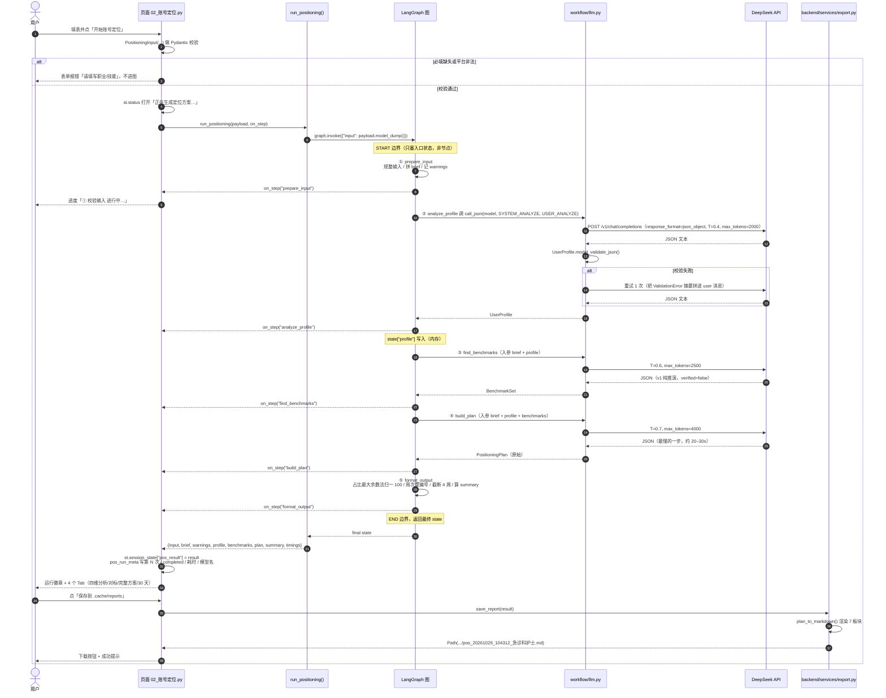
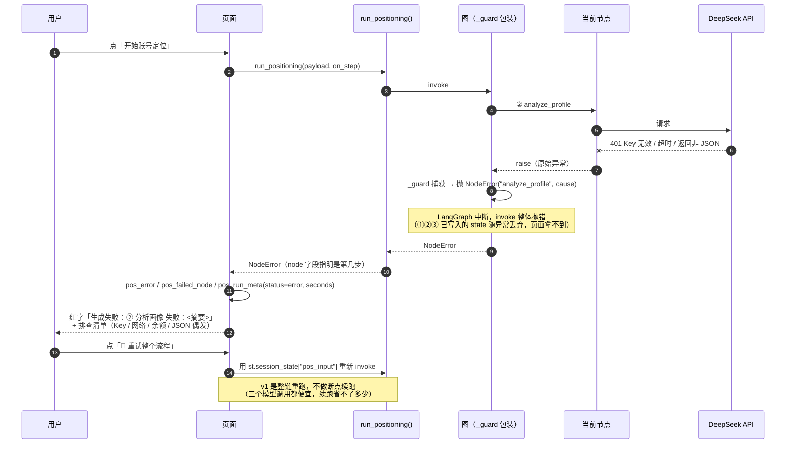
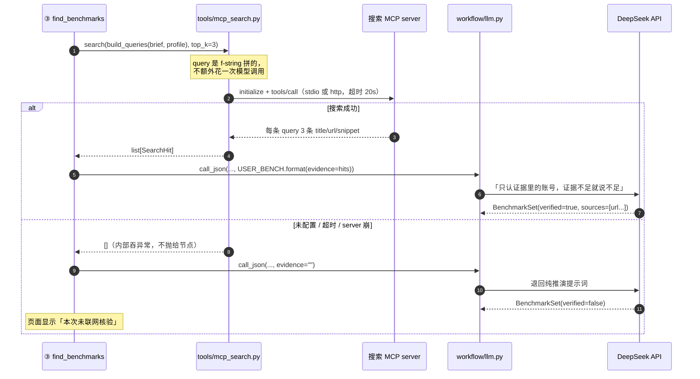
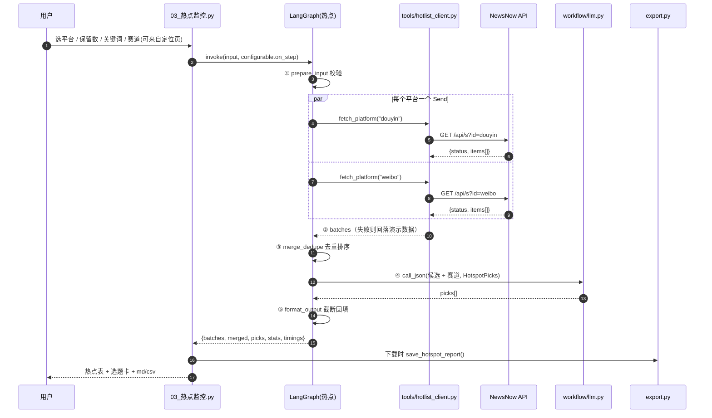

# SPEC v1 — 框架 + 账号定位 + 热点监控

> 对应 PRD v0.3 第 7.1 节 v1 清单。本文是**编码前的施工图**：字段级数据契约、节点提示词要点、页面线框、失败行为、验收标准。
> 状态：v0.4，规格冻结（实现过程中如需变更，先改本文再改代码）。

## 0. 实现现状（2026-10-29 晚，以代码为准）

v1 的引擎已切换为**用户自带的两套工作流**，本文第 3 节起的部分描述（5 节点结构化版、博查竞品）属于早期设计，保留作参考，与当前代码不一致处以下表为准：

| 位置 | 当前实现 | 说明 |
|---|---|---|
| 账号定位引擎 | `workflow/positioning.py`：`PositioningState{user_info, profile, competitors, plan}`，3 节点 `画像分析 → 对标搜索 → 方案生成`（温度均 0.7） | 全文本进出，不再有 Pydantic 结构化契约；跑完在 `run_positioning()` 内写库 |
| 热点监控引擎 | `workflow/hot_topic.py`：`fetch_douyin/weibo/zhihu/xiaohongshu/bilibili` 五节点 `Send` 并行 → `filter(0.4)` → `suggest(0.6)` | 经 `tools/trend_radar_client.py` 抓榜（含按位次估算的 `heat`） |
| 热榜客户端 | `tools/trend_radar_client.py`（TrendRadar / NewsNow，带重试） | 早期 `tools/hotlist_client.py` 未被引用 |
| LLM 入口 | `workflow/llm.py`：`get_model` / `safe_llm_call` / `call_json` / **`llm_call(prompt, temperature, max_tokens) -> str`** | 用户代码里 `from workflow.llm import llm_call` |
| 存储 | `db/session.py`：`positioning_records`（职业输入 / 画像 / 竞品 / 方案 / 时间）、`hot_topic_records`（平台 / 赛道 / 热榜原文 / 筛选 / 建议） | 连不上 PG 时退化为"不落库"，不阻塞页面 |
| 跨页 | `st.session_state["bridge"]["positioning"]` = `{record_id, user_info, track, profile, competitors, plan, updated_at}` | 热点监控页优先读会话，其次读数据库最近一条 |
| 页面 | `frontend/pages/02_账号定位.py`（三张卡：用户画像 / 竞品分析 / 定位方案）、`03_热点监控.py`（三张卡 + 热榜表 + 两张结果卡） | 卡片统一用 `frontend/components/cards.py: module_card()`，点开是弹窗全文 |
| 语音转写 | `tools/autodl_funasr.py`：SFTP 上传 → WebSocket 推流到 AutoDL 上的 FunASR（GPU）→ 返回 `{text, sentences, inference_ms}`；直连不通自动建 SSH 隧道 | `media_tools.audio_to_text()` 远程优先，失败退回本机 funasr；协议 v1，服务端 `/root/funasr_ws/funasr_ws_server.py` |
| 依赖 | uv 管理：`langgraph/langchain-openai` + `yt-dlp` + `edge-tts` + `trafilatura` + `moviepy` + `paramiko` + `psycopg` | `uv sync` 一条命令装齐 |

**未接入的早期文件**：`tools/bocha_client.py`（博查检索，当前无人调用；其余早期实现 `workflow/schemas.py`、`workflow/hotspot.py`、`tools/hotlist_client.py`、`backend/services/*`、`frontend/components/cards.py`、`db/schema.sql` 均已删除）。
**注意**：本文第 2、6、7 节描述的是**早期结构化设计**（Pydantic 契约 + 五阶段热点 + 服务层导出），保留作设计参考；当前代码只实现了第 0 节表格里的那一套，施工时以上表为准。

---

## 1. 目标与边界

**v1 只做三件事**：

1. 立起可扩展的工程骨架（多页导航、配置、LLM 封装、服务层、缓存目录）。
2. 把「账号定位」这一条链路**真正跑通**：3 项必填输入 → 5 节点 LangGraph → 7 个板块结果 → 导出 Markdown。
3. 把「热点监控」跑通：选平台 → 并行抓榜（`Send` 扇出）→ 合并去重 → LLM 按赛道筛选 → 选题清单（含开拍角度、难度）+ 导出 md/csv。

**v1 明确不做**：复刻/口播/剪辑/复盘的真实逻辑（只留占位页）、定位结果的历史记录列表、局部重生成、流式输出、定时刷新热点、小红书热榜（上游 500）、真实账号检索（对标仍是 LLM 推演）。

**验收口径**：一个没看过代码的人，按本文第 10 节清单逐条点，能全部通过。

---

## 2. 数据契约（Pydantic v2，`workflow/schemas.py`）

> 所有节点输出走 `model_json_schema()` 生成提示词里的 JSON 骨架，再用 `model_validate_json()` 校验；校验失败带着错误信息重试 1 次，仍失败则抛 `NodeError`。

### 2.1 输入

```python
class PositioningInput(BaseModel):
    occupation: str                      # 职业/身份，如"三甲医院护士"
    skills: list[str]                    # 核心技能 1–5 个，如["急救护理","科普写作"]
    interests: list[str]                 # 兴趣 1–5 个
    goal: Literal["涨粉","变现","打造个人品牌","记录生活","获客"]
    platforms: list[Literal["抖音","小红书","B站","视频号"]]   # 1–3 个
    # 以下为可选（高级折叠区），缺省不影响链路
    weekly_hours: int | None = None      # 每周可投入小时
    on_camera: bool | None = None        # 是否愿意出镜
    followers: int | None = None         # 现有粉丝数
    monetization_wish: str | None = None # 变现诉求：带货/接广/知识付费/私域/暂不考虑
```

### 2.2 ② 号节点输出 `UserProfile`

```python
class UserProfile(BaseModel):
    strengths: list[str]        # 3–5 条优势标签，每条 ≤ 12 字，必须来自"职业×技能×兴趣"的交集
    transferable: list[str]     # 2–4 条可迁移能力，说明"这个能力能解决谁的什么问题"
    themes: list[str]           # 3–5 个内容母题（可持续讲 3 个月以上的话题域）
    hook: str                   # 1 句差异化钩子：为什么是你来讲，≤ 40 字
    risks: list[str]            # 2–3 条风险提醒（赛道拥挤/合规红线/能力缺口）
```

### 2.3 ③ 号节点输出 `BenchmarkSet`

```python
class BenchmarkAccount(BaseModel):
    name: str                   # 账号名；没检索到真实账号时写"参考类型：XX类博主"
    platform: Literal["抖音","小红书","B站","视频号"]
    scale: str                  # 粉丝量级，如"1w–10w"；不知道写"量级未知"
    tag: str                    # 赛道标签，如"护士科普"
    url: str = ""               # 博查命中时填真实链接，否则必须为空
    hit_formula: str            # 爆款共性 1–2 句：选题+结构+情绪
    learn: str                  # 可借鉴点 1–2 句（具体到"怎么做"）
    caveat: str                 # 不可照搬的地方 1 句

class EvidenceItem(BaseModel):
    id: str                     # E1 … En
    title: str
    url: str
    site: str = ""
    snippet: str = ""
    published_at: str = ""

class BenchmarkSet(BaseModel):
    accounts: list[BenchmarkAccount]   # 3–5 个
    common_patterns: str               # 3 个共性打法，分号分隔
    differentiation: str               # 你的差异化切口 1–2 句
    verified: bool = False             # 至少一个账号拿到博查真实链接才为 True
    searched: bool = False             # 本次是否真的联网检索过
    queries: list[str] = []            # 实际发出的检索词（页面展示，便于判断质量）
    evidence: list[EvidenceItem] = []  # 博查命中，页面渲染"检索证据"表
```

> **v0.4 变更**：③ 号节点从"纯模型推演"升级为"博查检索 + 模型归纳"。
> 关键规则：`url` 必须在证据集合里，模型编的链接一律清空；`verified` 由代码判定而不是模型自报。

### 2.4 ④ 号节点输出 `PositioningPlan`（= 前端 7 个板块）

```python
class Audience(BaseModel):
    who: str        # 具体到身份+阶段，如"刚确诊糖尿病的 45–60 岁患者家属"
    pain: str       # 最痛的一个问题
    need: str       # 他想从你这里拿走什么

class ContentPillar(BaseModel):
    name: str                  # 支柱名，≤ 8 字
    desc: str                  # 讲什么、为什么这个支柱能承接受众
    ratio: int                 # 占比 %，所有支柱合计 = 100
    samples: list[str]         # 2–3 个示例选题（可直接拍的句子）

class Persona(BaseModel):
    names: list[str]           # 3 个候选账号名（含平台适配说明可省）
    bio: str                   # 简介 ≤ 60 字，含身份+价值+钩子
    catchphrase: str           # 口头禅/开场白 1 句
    visual: str                # 视觉风格 1–2 句（色调/场景/道具）

class Monetization(BaseModel):
    stage: Literal["0–1k粉","1k–1w粉","1w粉以上"]
    path: str                  # 变现方式，具体到"卖什么/接什么"
    note: str                  # 前置条件与风险

class WeekPlan(BaseModel):
    week: int                  # 1–4
    goal: str                  # 本周唯一目标
    posts: int                 # 发布条数
    actions: list[str]         # 3–5 条具体动作（可打勾）
    metrics: list[str]         # 1–3 个观察指标 + 及格线

class PositioningPlan(BaseModel):
    one_liner: str                    # 一句话定位，≤ 30 字
    audiences: list[Audience]         # 2–3 个，按优先级排序
    pillars: list[ContentPillar]      # 3–5 个，ratio 合计 100
    persona: Persona
    monetization: list[Monetization]  # 2–3 个阶段
    plan_30d: list[WeekPlan]          # 恰好 4 条
```

### 2.5 图状态（`PositionState`）

```python
class PositionState(TypedDict, total=False):
    input: dict              # PositioningInput.model_dump()
    profile: dict            # UserProfile
    benchmarks: dict         # BenchmarkSet
    plan: dict               # PositioningPlan
    failed_node: str | None  # 失败节点名，用于前端定位
    error: str | None
    timings: dict[str, float]
```

---

## 3. 节点规格（`workflow/positioning.py`）
五个节点，线性串行：`START → prepare_input → analyze_profile → find_benchmarks → build_plan → format_output → END`。

| # | 节点 | 函数 | temperature | max_tokens | 输入 | 输出 |
|---|---|---|---|---|---|---|
| ① | prepare_input | `prepare_input(state)` | — | — | `input` | `input`（规整）+ `brief` + `warnings` |
| ② | analyze_profile | `analyze_profile(state)` | 0.4 | 2000 | `brief` | `profile` |
| ③ | find_benchmarks | `find_benchmarks(state)` | 0.6 | 2500 | `brief` + `profile` + **博查证据** | `benchmarks`（含 `evidence/queries/searched/verified`） |
| ④ | build_plan | `build_plan(state)` | 0.7 | 4000 | `brief` + `profile` + `benchmarks` | `plan`（原始，未归一化） |
| ⑤ | format_output | `format_output(state)` | — | — | `plan` + `benchmarks` | `plan`（归一化）+ `summary` |

> ①⑤ 是不调模型的节点：把「校验 / 归一化」这类业务规则从 LLM 节点里剥出来，模型只负责生成；
> 出问题不浪费 token，也方便单测。数据只在 `PositionState`（TypedDict，`total=False`）里流转，**全程内存，不落库**。

**提示词通用约束（写进每个 system prompt）**：

1. 中文输出，禁止英文夹杂（专有名词除外）。
2. **禁止空话**：不得出现"热爱生活""持续输出优质内容""打造个人IP"这类无法执行的句子；每条结论必须能回答"明天做什么"。
3. 数值必须自洽：`pillars[].ratio` 合计 100；`plan_30d` 恰好 4 条；`week` 为 1–4。
4. 只输出 JSON，不要 markdown 代码块，不要解释。

**实现要点**：

- `call_json(model, system, user, schema_cls, retries=1)`：`response_format={"type":"json_object"}` → `schema_cls.model_validate_json` → 失败则把 `ValidationError` 摘要拼进第二轮 user 消息重试。
- 每个节点包 `_guard`：任何异常转成 `NodeError(node, cause)` 向上抛 → 页面显示"第 N 步（<名>）失败：<摘要>"，并把出错节点记进 `pos_failed_node`。**v1 是整链重跑**（不做断点续跑：三次调用都便宜，续跑省不下多少），见 4.2 时序图。
- 图：`StateGraph(PositionState)`，五节点线性，无分支、无条件边（v1 刻意不用 `send`／子图，热点监控那页才需要）。

**③ 号节点：联网检索的两种形态（v0.4 实装）**

```text
有 BOCHA_API_KEY
  └─ build_queries(brief, 职业, 平台) → 3 条检索词
     └─ search_many(per_query=5)   ← 2s 左右，返回 6–10 条，过垃圾域名/标题过滤
        ├─ 有证据 → SYSTEM_BENCH_WEB（只许引用 E1…En）→ 校验 url ∈ 证据集，否则清空
        │           → searched=True；至少一个 url 命中才 verified=True
        └─ 无证据 → 退回 SYSTEM_BENCH 推演 → searched=False, verified=False
无 key / 检索异常 → 直接推演，页面标"未联网"
```

**诚实标注**：不论哪种形态，prompt 都要求"不要编造精确粉丝数/爆款播放量"；
页面顶部按状态显示三种文案之一——`✅ 博查命中 N 条` / `⚠️ 本次未检索到有效网页，已降级为模型推演` / `ℹ️ 未配置 BOCHA_API_KEY，当前为模型推演`。

---

## 4. 时序图

> 画法约定：`on_step` 是**图 → 页面的单向下水道**（节点开始时喊一声），`st.status` 的进度条与"✅ 已完成"列表全靠它推进；页面永远不直接调节点函数，只调 `run_positioning()`。

### 4.1 主链路：一次成功的账号定位



### 4.2 失败分支：某个节点挂了怎么办



### 4.3 v2 形态：③ 号节点接 MCP 联网搜索



### 4.4 时序图 ↔ 代码对照

| 图中动作 | 代码位置 |
|---|---|
| 表单 → `PositioningInput` | `frontend/pages/02_账号定位.py` 的 `generate()` 调用处 |
| `st.status` 进度推进 | `generate()` 里的 `on_step()` 闭包 |
| `graph.invoke` 与 state 合并 | `workflow/positioning.py: run_positioning()` / `get_graph()` |
| `on_step` 下发 | `workflow/positioning.py: _emit()`（读 `config["configurable"]["on_step"]`） |
| JSON 校验 + 重试 1 次 | `workflow/llm.py: call_json()` |
| 归一化 | `workflow/positioning.py: normalize_plan()`，由 ⑤ 号节点调用 |
| 导出 Markdown | `backend/services/export.py: save_report()` |
| 异常 → `NodeError` | `workflow/positioning.py: _guard()` |

---

## 5. 页面线框（`frontend/pages/02_账号定位.py`）

```
┌─ 侧边栏 ─────────────┐  ┌─ 主区 ────────────────────────────────┐
│ 模型: deepseek-flash  │  │ 输入基本情况，AI 完成四维分析、联网对标与完整方案 │
│ 输出: .cache          │  │                                        │
│ ─────────────        │  │ ┌ 你的背景 ──────────────────────────┐ │
│ 💾 保存运行记录        │  │ │ 行业 ▾     目标平台 ▾  职业/身份 🔴* │ │
│ 📄 导出 Markdown      │  │ │ 目标人群   核心技能 🔴* 变现方式 ▾   │ │
│ 原始结果 JSON         │  │ │ 兴趣经历   内容风格   补充说明（整宽）│ │
│ 清空当前结果           │  │ │ ▸ 更多选项（目标/每周时长/出镜/粉丝数）│ │
│ ─────────────        │  │ │        [ 开始账号定位 ]             │ │
│ 账号定位…             │  │ └────────────────────────────────────┘ │
└───────────────────────┘  │ 运行 #9 · completed · 115.3s · deepseek-flash │
                           │ [🧬 四维分析][🔍 竞品分析][🗺 完整方案][📅 30天] │
                           │ ┌ 一句话定位（hero 大字卡片）──────────┐ │
                           │ │ 「……」 平台/人群/支柱 胶囊            │ │
                           │ └────────────────────────────────────┘ │
                           │ ┌ Tab 内容 ───────────────────────────┐ │
                           │ │ …                                   │ │
                           │ └────────────────────────────────────┘ │
                           └────────────────────────────────────────┘
```

**状态机**：

| 状态 | 表现 |
|---|---|
| 空态 | 主区只有表单 + 一段"三个真实例子"提示（已去掉硬编码示例按钮，改为 caption 提示） |
| 运行中 | `st.status("① 校验输入… ⑤ 组装方案")` 按 `on_step` 逐步 `update`（重复 label 去重）；表单禁用 |
| 成功 | 运行徽章（色块）+ 一句话定位 hero + 4 个 Tab；侧边栏出现保存/清空 |
| 部分失败 | 红色 `st.error("第 N 步（<名>）失败：<摘要>")` + 「重新运行」按钮；已完成节点结果保留 |
| 全失败/Key 错 | 页面顶部 `st.error` + 排查清单（检查 .env 的 DEEPSEEK_API_KEY / 网络 / 余额），绝不白屏 |
| 刷新 | 从 `st.session_state.pos_result` 恢复，无需重跑 |

**Tab 内容**（4 个，统一「卡片容器 + 弹窗」形态：一张卡=一个模块，卡内只放标题/预览/配图，点「展开查看」在弹窗里读完整 Markdown，图片跟着所属条目走，不单独成墙）

- 🧬 四维分析：① 能力优势 / ② 可迁移能力 / ③ 内容母题 / ④ 风险提醒 四张卡（2 列），点开是带序号的 Markdown 列表。
- 🔍 竞品分析：三态状态条（博查命中 N 条 / 未检索到有效网页 / 未配置 key）→ 检索词 → 四张卡：① 竞品账号（点开看每条账号的爆款共性/可借鉴/不可照搬 + 主页链接）、② 共性打法、③ 差异化切口、④ 检索证据（点开是「ID / 标题 / 网页链接 / 文本内容」总表 + 每条证据的正文与配图）。
- 🗺 完整方案：① 目标受众 / ② 内容版图（含占比表 + 每支柱示例选题）/ ③ 人设打造 / ④ 变现路径 四张卡；底部 `st.download_button` 下载 Markdown。
- 📅 30 天计划：每周一张卡，点开是发布条数 + 动作 checklist + 观察指标。

---

## 6. 热点监控（`workflow/hotspot.py` + `frontend/pages/03_热点监控.py`）

> 与账号定位的区别：**② 抓榜是并行的**（LangGraph `Send` 扇出），其余四步仍是单节点串行。抓榜失败不阻断全链，降级为演示数据并在页面显式标注。

### 6.1 数据契约

```python
HotPlatformKey = Literal["douyin", "weibo", "bilibili", "toutiao", "zhihu"]

class HotspotInput(BaseModel):
    platforms: list[HotPlatformKey] = ["douyin", "weibo", "bilibili"]
    limit: int = 8          # 想保留几条选题，3–20
    keyword: str = ""       # 追加关键词，逗号分隔
    fans: int | None = None # 当前粉丝量，影响选题难度建议
    track: str = ""         # 赛道；空则退回用 keyword

class HotspotPick(BaseModel):
    title: str              # 热榜原标题，一字不改
    platform: str           # 来自哪个榜
    relevance: int          # 0–100，<40 直接丢弃
    angle: str              # 20–40 字，可直接开拍的切入点
    difficulty: Literal["易", "中", "难"]
    why: str                # 为什么适合这个账号，不复述标题

class HotspotPicks(BaseModel):
    picks: list[HotspotPick]
    note: str               # 整体判断，2–3 句
```

`HotspotState`：

```python
class HotspotState(TypedDict, total=False):
    input: dict
    track: str
    warnings: list[str]
    batches: Annotated[list[dict], operator.add]   # 并行写回必须带 reducer
    merged: list[dict]
    picks: dict
    stats: dict
    timings: dict
```

### 6.2 五个阶段与并行机制

| # | 节点 | 做什么 | 调模型 |
|---|---|---|---|
| ① | `prepare_input` | 校验 `HotspotInput`、平台去重、剔除已知不可用的 `xiaohongshu`；缺赛道/关键词时给 warning | 否 |
| ② | `dispatch_fetch` → `fetch_one` | `dispatch_fetch` 只推进度；条件边 `fan_out()` 返回 `[Send("fetch_one", {...}) for 平台]`，LangGraph **同一超步并发执行**，各写一条 `batches` | 否 |
| ③ | `merge_dedupe` | 标题归一化（去空白/标点/大小写）后去重，跨平台同题合并成一条并累计 `platforms`、取 `best_rank`，按位次排序 | 否 |
| ④ | `ai_filter` | 把候选清单（标题 + 榜单位次 + 平台）与赛道/关键词/粉丝量一起交给模型，输出 `HotspotPicks`；候选为空则跳过模型 | 是 |
| ⑤ | `format_output` | clamp 相关度、按相关度排序、截到 `limit`、从 `merged` 回填 `url`/`rank`、统计 live/cache/demo 数量 | 否 |

实现要点（踩过的坑）：

- `fetch_one(state, config=None)` 的第二个参数**必须留着**：LangGraph 见到两参签名就会注入 `RunnableConfig`，删掉会报 `fetch_one() takes 1 positional argument but 2 were given`。
- `fan_out` 不能写成普通节点（它是条件边的路由函数），返回值只能是 `list[Send]` 或节点名。
- 并行分支的写回字段必须带 reducer，否则同超步多次写 `batches` 会冲突。



### 6.3 数据源与降级

| 平台键 | 名称 | 实测 |
|---|---|---|
| `douyin` | 抖音热榜 | 200，`status: cache`，30 条 |
| `weibo` | 微博热搜 | 200，`status: cache`，30 条 |
| `bilibili` | B站热榜 | 200，`status: success`，30 条 |
| `toutiao` | 头条热榜 | 200，30 条 |
| `zhihu` | 知乎热榜 | 200（未纳入默认勾选） |
| `xiaohongshu` | 小红书 | **HTTP 500，v1 不提供** |

- 接口：`{TRENDRADAR_API_URL}?id=<平台>`，返回 `{status, id, updatedTime, items:[{title,url,extra?}]}`。**没有热度数值**，只有榜单顺序 → 用 `rank = 下标+1` 作热度代理，页面只讲"榜单位次"，不编造热度。
- 降级规则：请求异常或条目为空 → 返回 6 条内置演示数据，`title` 统一以「演示数据：」开头，`status="demo"`；页面顶部黄条提示"以下为演示数据，请检查网络"。**任何情况下都不抛错、不白屏**。
- 平台清单只放在 `tools/hotlist_client.py: PLATFORMS`，页面与图都从它取，避免三处各写一份。

### 6.4 页面线框

```
┌ 热点监控 ─────────────────────────────────────────────┐
│ 当前定位：<一句话定位> · 赛道：<3 个赛道词>            │  ← 来自 02 页 bridge
│ 监控平台* [抖音热榜][微博热搜][B站热榜][] 保留热点数 ▁▂▃ │
│ 追加关键词（选填）        当前粉丝量（选填）            │
│ [ 开始监控 ]                                          │
│ 运行 #2 · 状态 completed · 耗时 14.6s                  │
│ ⚠️ 抖音热榜：演示数据（网络异常）                       │
│ 整体判断（hero）                                       │
│ 平台状态胶囊：🟢 实时 2 · 🟡 缓存 1 · ⚪ 演示 0         │
│ 热点表（相关度进度条 / 位次 / 平台 / 难度 / 开拍角度）   │
│ 选题卡 ×N：标题 + 难度 + 为什么适合你 + 看原榜           │
│ [下载 Markdown] [下载 CSV]                              │
└───────────────────────────────────────────────────────┘
```

---

## 7. 文件清单（v1 要新建/改写的文件）

| 文件 | 动作 | 职责 |
|---|---|---|
| `frontend/app.py` | 新建 | `st.navigation` 入口，注册首页 + 6 个功能页（路径相对 `frontend/`） |
| `frontend/pages/01_首页.py` | 新建 | 6 个模块卡片，标"已上线/规划中" |
| `frontend/pages/02_账号定位.py` | 新建 | 本规格第 5 节 |
| `frontend/pages/03_热点监控.py` | 新建 | 本规格第 6 节 |
| `frontend/pages/04~07_*.py` | 新建 | 占位：标题 + 一句话说明 + 与其他模块的关系 + `st.info("v2 上线")` |
| `frontend/components/ui.py` | 新建 | `esc/page_header/hero_card/chips/bullets/card_grid/sidebar_footer` |
| `workflow/schemas.py` | 新建 | 第 2 节 + 第 6.1 节全部模型 |
| `workflow/positioning.py` | 新建 | 5 节点 + 图 + `run_positioning(payload) -> dict` |
| `workflow/hotspot.py` | 新建 | 5 阶段 + `Send` 并行抓榜 + `run_hotspot(payload) -> dict` |
| `tools/hotlist_client.py` | 新建 | `PLATFORMS` / `fetch_platform` / `fetch_many` / 演示数据兜底 |
| `workflow/llm.py` | 改写 | 修 GBK 乱码注释→UTF-8；加 `call_json`/`call_json_safe`；超时 120s |
| `config.py` | 改写 | 沿用 `.env` 键名（不做 alias）；`api_key` 缺失时给友好提示而非 import 崩溃；目录幂等创建 |
| `backend/services/cache.py` | 新建 | `save_json(name, obj)` / `load_json(path)`，落 `.cache/` |
| `backend/services/export.py` | 新建 | `plan_to_markdown` / `save_report`，`.cache/reports/pos_<ts>_<slug>.md`；`hotspot_to_markdown` / `hotspot_to_csv` / `save_hotspot_report` |
| `.env.example` | 填充 | 当前是 0 字节，补齐全部键与注释 |
| `.gitignore` | 新建 | `.venv/ .cache/ .env __pycache__/ *.pyc .streamlit/` |

**不改**：`pyproject.toml` 依赖（v1 无需新包）、`uv.lock`。

---

## 8. session_state 约定

| key | 类型 | 说明 |
|---|---|---|
| `pos_input` | dict | 最近一次提交的表单值（刷新后回填） |
| `pos_result` | dict | `{input, brief, warnings, profile, benchmarks, plan, summary, timings, run_id}` |
| `pos_failed_node` / `pos_error` | str \| None | 失败节点与错误摘要 |
| `pos_run_meta` / `pos_run_count` | dict / int | 运行徽章用的 `{no,status,seconds,model}` |
| `hot_input` | dict | 热点页表单值（刷新后回填） |
| `hot_result` | dict | `{input, track, warnings, batches, merged, picks, stats, timings, run_id}` |
| `hot_failed_node` / `hot_error` | str \| None | 失败节点与错误摘要 |
| `hot_run_meta` / `hot_run_count` | dict / int | 运行徽章 |
| `bridge` | dict | 跨页传参：`bridge["positioning"] = {one_liner, occupation, industry, platforms, audiences, pillars, persona_names, updated_at, run_id}`，热点页据此带入赛道并展示"当前定位" |

---

## 9. 配置项（v1 最终形态）

```ini
DEEPSEEK_API_KEY=sk-xxx
BASE_URL=https://api.deepseek.com/v1
MODEL_NAME=deepseek-flash
LLM_TIMEOUT=120
CACHE_DIR=./.cache
REPORT_DIR=./.cache/reports
PLAN_DIR=./.cache/plans
VIDEO_OUTPUT_DIR=./.cache/videos
IMAGE_DIR=./.cache/images
BOCHA_API_KEY=              # 博查检索；留空则③号节点退回"模型推演"
BOCHA_SEARCH_URL=https://api.bochaai.com/v1/web-search
COLLECT_FULL_TEXT=false     # 采集规模总开关：false=省 token/省库（测试期默认）
MAX_TEXT_CHARS=400          # 单条正文最多保留字数（true 时生效）
MAX_ITEMS_PER_SOURCE=30     # 单源最多保留条数
DATABASE_URL=               # 留空=用 .cache/plans 的 json；填了需 uv add "psycopg[binary]"
FFMPEG_PATH=                # 留空则用 PATH，v2 才需要
TRENDRADAR_API_URL=https://newsnow.busiyi.world/api/s
HEYGEM_HOST=http://localhost:8383
HEYGEM_TTS_URL=http://localhost:18180
HEYGEM_ASR_URL=http://localhost:10095
HEYGEM_DATA_DIR=c:/duix_avatar_data/face2face
TTS_ENABLED=true
TTS_VOICE=zh-CN-XiaoxiaoNeural
DEEPAGENT_MODEL=deepseek-flash
```

字段名与 `.env` 键名**一一对应、不做 alias**（用户明确要求 Settings 保持朴素写法）；`api_key` 为空时 **不抛异常**，用 `Settings.api_key_ok: bool` 供页面显示"未配置 Key"。

---

## 10. 验收清单（v1 完成的标准）

账号定位：

- [ ] `uv run streamlit run frontend/app.py` 启动，控制台无 Traceback
- [ ] 侧边栏 首页 + 6 个功能页可切换，无报错
- [ ] 首页 6 张卡片状态正确（账号定位、热点监控=已上线，其余=规划中）
- [ ] 账号定位页填 3 项必填（职业 🔴* / 核心技能 🔴* / 目标平台 🔴*）→ 点击生成 → 5 个阶段依次完成
- [ ] 结果含：四维分析、竞品分析、一句话定位、2–3 受众、3–5 支柱（占比合计 100）、人设、按阶段变现、4 周计划
- [ ] 竞品分析 Tab：显示"博查命中 N 条 / 未检索到有效网页 / 未配置 key"三态之一；检索词可见；证据表列为 ID / 标题 / 网页链接 / 文本内容；点"🔍 放大"能弹出图片预览（无图时为占位块）
- [ ] 博查不可用（清空 `BOCHA_API_KEY` 或断网）→ 仍能出完整方案，页面明确标"未联网/已降级"，不白屏
- [ ] 按 F5 刷新 → 结果仍在（session_state），运行徽章保留
- [ ] 侧边栏"💾 保存运行记录" → 报出后端（file / postgres）与文件名；`.cache/plans/positioning_*.json` 生成且含 `benchmarks.evidence`
- [ ] 侧边栏"📄 导出 Markdown"或 Tab 内下载 → `.cache/reports/pos_*.md` 生成，内容含输入快照 + 全部板块 + 检索证据表
- [ ] 把 `.env` 的 Key 改成 `sk-invalid` → 页面红字提示 + 排查清单，不白屏、不卡死
- [ ] `uv run python -c "import config; print(config.settings.model_name)"` → 读出 `.env` 里的模型名

热点监控：

- [ ] 03 页默认勾选 抖音/微博/B站，点"开始监控"→ 5 个阶段依次完成，耗时含"抓榜"与"AI 筛选"两段
- [ ] 三个平台并行抓取：抓榜耗时明显小于三平台串行之和（实测串行 3.2s，并行 1.0–1.9s）
- [ ] 热点表按相关度降序，含位次 / 平台 / 难度 / 开拍角度；跨平台同题只出现一次，`platforms` 显示多个来源
- [ ] 选题数 ≤ 保留数；相关度全部 ≥ 40；标题与热榜原文一致
- [ ] 断网或把 `TRENDRADAR_API_URL` 改成不存在的域名 → 页面给出"演示数据"黄条提示，其余流程照常，不白屏
- [ ] 下载 Markdown / CSV 成功，md 含"本周可做选题"与"数据来源"两节
- [ ] 先在 02 页跑一次定位，再进 03 页 → 顶部显示"当前定位"且赛道自动带入

工程：

- [ ] `uv run python .cache/dev/smoke_check.py` 7 项全过
- [ ] `uv run python .cache/dev/render_check.py` 7 个页面 exc=0
- [ ] `git status` 无 `.env`、`.cache`、`.venv` 被跟踪

---

## 11. 决策点（2026-10-29 用户确认）

| # | 问题 | 决定 | 落地点 |
|---|---|---|---|
| D1 | 输入字段 | **3 项必填（职业 / 核心技能 / 目标平台）+ 6 项常规可选 + 4 项"更多选项"** | 第 2.1 节 `PositioningInput`；第 5 节表单 |
| D2 | 结果布局 | **运行徽章 + 一句话定位 hero 卡片 + 4 个 Tab**（四维分析 / 对标账号 / 完整方案 / 30 天计划） | 第 5 节"成功"态 |
| D3 | 历史记录 | **v1 不落盘**，只在 `session_state`；`.cache/reports` 只在用户主动保存/下载时写 | 第 7 节；v2 再开历史列表 |
| D4 | 局部重生成 | **v1 不支持**，只能整链重跑 | 失败态只提供"重新运行" |
| D5 | 入口位置 | **根目录不放入口脚本**，Streamlit 入口为 `frontend/app.py`，页面在 `frontend/pages/` | 第 7 节文件清单 |
| D6 | v1 范围 | **两个功能模块**（账号定位 + 热点监控），其余四页占位 | PRD §7.1 |
| D7 | 热点数据源 | **NewsNow 免 key 接口**（TrendRadar 同源），不接小红书（500），不编造热度值 | 第 6.3 节 |
| D8 | 缺省配置 | `Settings` 字段名 = `.env` 键名，不用 alias；`api_key` 可空不崩 | `config.py`；第 9 节 |
| D9 | 竞品分析数据源 | **博查 API**（`BOCHA_API_KEY`），③ 号节点改"检索 + 归纳"，`url` 必须在证据集内；检索失败降级模型推演并显式标注 | 第 2.3 / 3 节；`tools/bocha_client.py` |
| D10 | 采集规模 | **`COLLECT_FULL_TEXT` 布尔开关，默认 false**（只留标题/链接/摘要 160 字）；true 才抓正文与 og:image | `config.py`、`tools/bocha_client.py` |
| D11 | 结果存储 | **文件为主（`.cache/plans/*.json`）+ PG 可插拔**（`DATABASE_URL` 连得上且装了 psycopg 才写 `runs`） | `backend/services/repository.py`、`db/schema.sql` |
| D12 | 必填标记 | 用 `:red[*]` 彩色星标，不用裸 `*`（避免被当斜体） | 02 页表单 |

> 本规格自本行起视为**冻结**；实现过程中如需变更，先改本文再改代码。

---

## 12. 环境现状（2026-10-29 实测）

- Python 3.12.13（`.venv`，uv 0.11.28 创建），已装 streamlit / langgraph / langchain-openai / pydantic-settings / pandas / numpy / pillow / uvicorn 等；v1 无需新增依赖。
- **ffmpeg 不在 PATH** → v2「视频剪辑」的前置条件，v1 不受影响；届时需装 ffmpeg 并在 `.env` 填 `FFMPEG_PATH`。
- node/npx 可用（`D:\System-environment\node\0\`），docker 可用，nvidia-smi 可用 → HeyGem 环境具备。
- `.env` 已有内容（214B，含 `DEEPSEEK_API_KEY`、`MODEL_NAME=deepseek-flash`）；`.env.example` 已补齐全部键。可用模型实测为 `deepseek-flash` / `deepseek-v4-pro`（`/v1/models`）。
- NewsNow 接口实测：douyin/weibo/bilibili/toutiao/zhihu 均 200；**xiaohongshu 500**。返回项无热度数值，只有榜单顺序。
- 网络注意：**沙箱里 PowerShell 的 `Invoke-WebRequest` 不通**（"基础连接已经关闭"），验证网络一律用 `.venv\Scripts\python.exe` + `urllib`。
- 依赖与缓存的边界：装好的包在 `.venv\`（319MB），uv 的**下载缓存**在 `%LOCALAPPDATA%\uv\cache`，项目目录里不需要也不应该出现 `.uv-cache\`。
- 自检脚本放在 `.cache/dev/`（被 git 忽略）：`smoke_check.py`（7 项契约/图/导出检查）、`render_check.py`（7 页渲染）、`result_render_check.py`（结果态渲染）、`live_run.py` / `hot_live.py`（真调模型）、`live_run_bocha.py`（带博查的定位全链）、`_repo_probe.py`（存储探针）。
- **博查 API**（2026-10-29 实测）：`POST https://api.bochaai.com/v1/web-search`，`Bearer` 鉴权，返回 `data.webPages.value[]`；字段只有 `name/url/snippet/summary/siteName/siteIcon/datePublished`，**没有图片**，配图靠 og:image 兜底。`site:douyin.com` 语法无效；结果混大量 SEO 农场，需黑名单过滤（见 `JUNK_DOMAINS`）。
- **PostgreSQL（已接通）**：`127.0.0.1:5433` 是 PG **18.6**（Debian 构建，`postgres/password` 可连，库 `langgraph` 已存在，里面还有 checkpoint_*/users/consultations 等别的项目的表）；`5432` 同口令被拒（`password authentication failed`）。
  - 驱动：`uv add "psycopg[binary]"` 已装 **psycopg 3.3.6**（写入 `pyproject.toml`）。
  - 建表：`db/schema.sql` 已在 `langgraph` 库执行，新增 `runs` / `plans` / `evidences` 三张表。
  - 实测写入：`PgStore.save("positioning", <护士样例>)` → `postgres:runs#2`，19452 字节，`select count(*) from runs` = 2。
  - **唯一待办**：`.env` 里 `DATABASE_URL` 的端口写的是 **5434**，需用户改成 **5433**（`.env` 受安全策略保护，模型无权读写），否则 `get_store()` 探测失败会静默回落文件存储。
